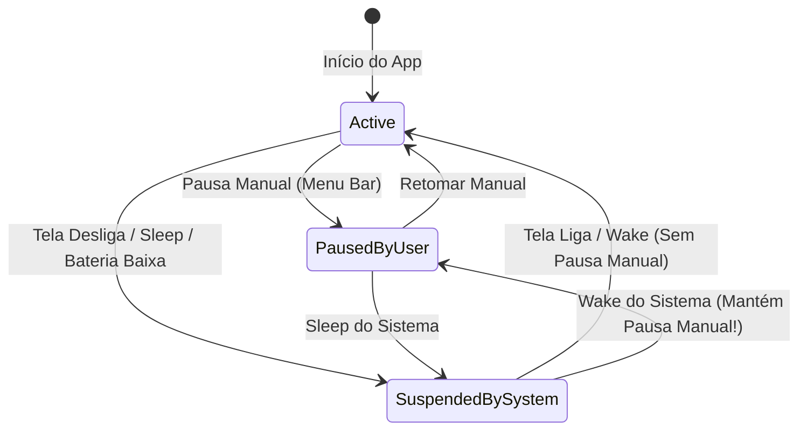

# Parecer Arquitetural e Análise de Riscos — Wallmotion (macOS 14+)

**Data:** Outubro de 2026  
**Autor:** Antigravity (Architecture Research Agent)  
**Destinatário:** Codex Coordenador & Equipe Wallmotion  
**Alvo:** macOS 14.0+ (Sonoma / Sequoia)  
**Contexto:** Parecer técnico formal para o desenvolvimento do MVP (Issues #1 a #6).

> [!NOTE]
> **Nota de Escopo e Metodologia:** Este relatório consolida recomendações arquiteturais e diretrizes de design técnico para guiar a implementação, não constituindo homologação ou QA concluído. Hipóteses operacionais e estimativas teóricas de consumo devem ser validadas empiricamente por meio de testes e perfilamento em hardware real.

---

## 1. Resumo Executivo e Recomendação de Arquitetura

O Wallmotion tem como objetivo disponibilizar um motor nativo, leve e sem fricção de papéis de parede animados no macOS 14+, utilizando estritamente **APIs públicas** da Apple (`AppKit`, `AVFoundation`, `SwiftUI`, `CoreGraphics`, `IOKit`).

### Decisões Centrais Recomendadas para o MVP:
1. **Camada de Exibição:** Instâncias dedicadas de `NSWindow` borderless e sem foco por display físico, posicionadas estrategicamente no nível `kCGDesktopWindowLevelKey + 1` (abaixo dos ícones do Finder), com `ignoresMouseEvents = true` e `collectionBehavior = [.canJoinAllSpaces, .stationary, .ignoresCycle, .fullScreenAuxiliary]`.
2. **Motor de Renderização:**
   - **Fotos e GIFs:** `NSImageView` nativo configurado com `animates = true` para suporte imediato sem bibliotecas externas.
   - **Vídeos Locais (MP4/MOV):** `AVQueuePlayer` associado a `AVPlayerLooper` e `AVPlayerLayer(videoGravity: .resizeAspectFill)` mutado por padrão (`isMuted = true`).
   - **Vídeos Remotos / HLS (.m3u8):** `AVPlayer` dedicado com observação de `AVPlayerItemDidPlayToEndTimeNotification` (para arquivos finitos) e tolerância a stalls de rede para fluxos contínuos (onde `AVPlayerLooper` não opera).
3. **Persistência Confiável:** Gravação atômica (`Data.write(to:options: .atomic)`) em arquivo JSON versionado (`Application Support/Wallmotion/library.json`), gerenciando importação por cópia imutável dos arquivos de mídia para a sandbox de dados do aplicativo.
4. **Gerenciador de Energia & Estado de Pausa:** Máquina de estados desacoplada entre **pausa intencional do usuário** (`isUserPaused: Bool`) e **restrições externas do sistema** (`systemPauseReasons: Set<PauseReason>`). Ao acordar da suspensão ou plugar o carregador, o app **nunca** deve retomar a reprodução se o usuário a pausou manualmente.

---

## 2. Janelas Desktop (`NSWindow`), Múltiplos Monitores e Spaces

### 2.1 Posicionamento da Janela e Nível de Camada
No subsistema de janelas do macOS (Quartz Compositor), a área de trabalho não é uma superfície comum:
- O wallpaper padrão do sistema reside em `kCGDesktopWindowLevelKey` (ou `Int(CGWindowLevelForKey(.desktopWindow))`, valor `-2147483623`).
- Os ícones da mesa do Finder residem em `kCGDesktopIconWindowLevelKey` (ou `Int(CGWindowLevelForKey(.desktopIconWindow))`, valor `-2147483603`).

```swift
// Configuração recomendada para a janela de wallpaper
let desktopLevel = Int(CGWindowLevelForKey(.desktopWindow))
window.level = NSWindow.Level(desktopLevel + 1)
window.styleMask = [.borderless]
window.isOpaque = false
window.backgroundColor = .clear
window.hasShadow = false
window.ignoresMouseEvents = true
window.sharingType = .none // Otimização de segurança e composição no Quartz
```

> [!IMPORTANT]
> A janela **deve** ter `ignoresMouseEvents = true` habilitado explicitamente. Isso garante que todos os cliques, seleções retangulares e ações de arrastar arquivos na mesa sejam repassados diretamente para o Finder, sem interceptação indesejada pelo Wallmotion.

### 2.2 Comportamento em Spaces e Mission Control
Para que a janela permaneça estática atrás dos conteúdos enquanto o usuário transita entre diferentes desktops virtuais (Spaces):
```swift
window.collectionBehavior = [
    .canJoinAllSpaces,     // Visível em todos os Spaces
    .stationary,           // Imune a movimentos de Mission Control e Exposé
    .ignoresCycle,         // Não aparece no ciclo Cmd+Tab / alternador de janelas
    .fullScreenAuxiliary   // Permanece presente ao lado de apps em modo tela cheia nativo
]
```

### 2.3 Riscos Concretos e Pitfalls:
1. **Espaços Fullscreen Exclusivos:** Quando um app comum entra em tela cheia (criando um Space dedicado do tipo fullscreen), o macOS prioriza a janela do aplicativo em foco. Janelas com `.fullScreenAuxiliary` são tratadas como auxiliares, mas em certos cenários de tela cheia ou Stage Manager, o Compositor do macOS pode ocultar o nível desktop. O escopo do MVP deve documentar que o wallpaper animado é primariamente visível na Mesa (Desktop Spaces).
2. **Ciclo de Vida de Displays:** Monitores externos são conectados, desconectados, colocados em espelhamento ou têm resolução alterada a quente.
   - **Solução:** Observar `NSApplication.didChangeScreenParametersNotification`.
   - **Âncora estável:** Nunca indexar displays por ordem no array `NSScreen.screens` (que varia com o foco). Utilizar o identificador `CGDirectDisplayID` extraído de `screen.deviceDescription[NSDeviceDescriptionKey("NSScreenNumber")]` como chave primária de atribuição.
   - Em caso de desconexão, o motor deve preservar a configuração associada àquele display e liberar os recursos (`AVPlayer`, camadas) para economizar RAM/VRAM.

---

## 3. NSImageView para Fotos e GIFs Animados

### 3.1 Viabilidade e Implementação
O `NSImageView` nativo do AppKit é suficiente para renderizar imagens estáticas (JPEG, PNG, HEIC, WebP, TIFF) e GIFs animados sem recorrer a componentes externos de WebKit ou bibliotecas de terceiros:
```swift
let imageView = NSImageView(frame: frame)
imageView.imageScaling = .scaleAxesIndependently // ou .scaleProportionallyUpOrDown
imageView.animates = true
imageView.canDrawSubviewsIntoLayer = true
```

### 3.2 Riscos Concretos e Pitfalls:
1. **Risco Teórico de Memória (RAM):** O decodificador embutido do AppKit descompacta quadros de GIF em bitmaps não comprimidos na memória (RGBA por frame). Em animações com muitos quadros e alta resolução, isso constitui uma hipótese de risco de pressão de memória (`jetsam`/swap) que deve ser verificada via profiling no Instruments (Allocations).
2. **Consumo de CPU em Main RunLoop:** A temporização do `animates = true` em GIFs roda atrelada a timers do AppKit na Main Thread. Animações longas podem gerar gasto contínuo de ciclos da thread principal.
3. **Mitigação para o MVP:**
   - Para o MVP, aceitar GIFs via `NSImageView`, mas registrar na UI e documentação a recomendação de vídeos em formato H.264/HEVC para animações de longa duração ou alta resolução.
   - No gerenciamento de energia, ao pausar, ajustar `imageView.animates = false` imediatamente para suspender a execução de timers da thread principal.

---

## 4. AVQueuePlayer + AVPlayerLooper para Vídeos Locais

### 4.1 Viabilidade e Benefícios
Para vídeos locais em contêineres padrão (`.mp4`, `.mov`, `.m4v`), `AVPlayerLooper` (introduzido no macOS 10.12+) é a solução recomendada pela Apple:
- Fornece transição contínua sem interrupções visíveis (seamless loop), pré-enfileirando cópias do `AVPlayerItem` dentro de um `AVQueuePlayer`.
- Descarrega a decodificação para a GPU e aceleradores dedicados de hardware (`VideoToolbox` / Apple Silicon Media Engine), reduzindo substancialmente a carga de decodificação na CPU (o consumo efetivo deve ser aferido em runtime).

```swift
let queuePlayer = AVQueuePlayer()
queuePlayer.isMuted = true
queuePlayer.actionAtItemEnd = .none

let playerLayer = AVPlayerLayer(player: queuePlayer)
playerLayer.videoGravity = .resizeAspectFill

let playerItem = AVPlayerItem(url: localFileURL)
let looper = AVPlayerLooper(player: queuePlayer, templateItem: playerItem)
```

### 4.2 Riscos Concretos e Pitfalls:
1. **Áudio Ativo e Silenciamento Defensivo:** Como boa prática de arquitetura para wallpapers de mesa, os players devem operar silenciados (`player.isMuted = true`) para evitar interferência na experiência acústica do usuário. As hipóteses sobre se players com áudio não silenciado bloqueariam o repouso do sistema via *power assertions* ou assumiriam o Centro de Controle ("Now Playing") devem ser validadas empiricamente com comandos como `pmset -g assertions`.
2. **Requisitos de Asset Looping:** `AVPlayerLooper` exige que a duração do asset seja finita e positiva (`asset.duration.isNumeric`). Tentar instanciar `AVPlayerLooper` com itens de streaming ou ativos corrompidos lança exceções ou falha silenciosamente.
3. **Liberação de VRAM:** Manter o `AVPlayerLayer` ativo com loop executando consome recursos de textura no WindowServer. Ao ocultar ou pausar a tela, `player.pause()` deve ser acionado.

---

## 5. AVPlayer Remoto e Transmissões HLS (.m3u8)

### 5.1 Incompatibilidade do AVPlayerLooper com HLS / Live Streams
> [!WARNING]
> **`AVPlayerLooper` não suporta fluxos ao vivo (live HLS / `.m3u8`) nem streams de duração indefinida.** Tentar anexar um template de stream dinâmico a um `AVPlayerLooper` gera falhas internas no AVFoundation.

### 5.2 Estratégia Diferenciada por Tipo de Mídia Remota:
1. **Vídeo Remoto Finito (.mp4 por HTTPS):**
   - Utilizar `AVPlayer` padrão (sem looper).
   - Observar a notificação `AVPlayerItemDidPlayToEndTimeNotification`:
     ```swift
     NotificationCenter.default.addObserver(
         forName: .AVPlayerItemDidPlayToEndTime,
         object: player.currentItem,
         queue: .main
     ) { [weak player] _ in
         player?.seek(to: .zero, toleranceBefore: .zero, toleranceAfter: .zero)
         player?.play()
     }
     ```
2. **Stream HLS / Live (.m3u8):**
   - Reprodução contínua linear sem looping de fim de item.
   - Observar `AVPlayerItem.isPlaybackBufferEmpty` e `AVPlayerItemPlaybackStalledNotification` para exibir indicadores não obstrusivos de reconexão ou manter o último quadro renderizado até o restabelecimento da rede.

### 5.3 Riscos Concretos e Pitfalls:
1. **App Transport Security (ATS):** Conexões HTTP inseguras são sumariamente bloqueadas pelo sistema. O validador deve exigir esquema `https://` obrigatório.
2. **Bloqueio de URLs de Páginas Web:** Usuários tendem a colar links de visualização (`youtube.com/watch?...`, `vimeo.com/...`). O AVFoundation **não é um navegador** e não processa HTML/JavaScript. O validador sintático no `WallmotionCore` deve barrar domínios conhecidos e extensões web (`.html`, `.php`), exigindo URLs diretas de contêiner de mídia.
3. **Consumo de Banda e Desconexão:** Streams ao vivo 24/7 consomem largura de banda contínua. Devem ser obrigatoriamente pausados em repouso de tela, suspensão do sistema ou desconexão de rede (`NWPathMonitor`).

---

## 6. Persistência Atômica e Gerenciamento de Arquivos

### 6.1 Escrita Atômica do Estado
Para evitar corrupção de dados em caso de encerramento forçado do processo ou falta de energia repentina:
```swift
let encoder = JSONEncoder()
encoder.outputFormatting = [.prettyPrinted, .sortedKeys]
let data = try encoder.encode(libraryDocument)
try data.write(to: targetURL, options: .atomic)
```
A opção `.atomic` instrui o subsistema de arquivos (APFS) a gravar os bytes em um arquivo temporário no mesmo volume e realizar uma substituição atômica via `renamex_np(..., RENAME_SWAP)` ou substituição segura, garantindo que o arquivo nunca fique truncado ou incompleto.

### 6.2 Versionamento e Recuperação de Erros
1. O payload JSON deve conter um campo `schemaVersion: Int = 1`.
2. Se o aplicativo encontrar um arquivo com versão superior ou estrutura JSON corrompida:
   - **Não sobrescrever** o arquivo com um estado vazio.
   - Criar uma cópia de segurança (`library.json.corrupted-<timestamp>`).
   - Apresentar alerta visível ao usuário informando o erro de leitura para evitar perda silenciosa dos dados configurados.

### 6.3 Gestão Local da Mídia Importada
Para evitar perda de referência quando o usuário move, renomeia ou apaga o arquivo original na pasta de Downloads ou Fotos:
- O `WallmotionCore` deve copiar o arquivo de mídia para `~/Library/Application Support/Wallmotion/Media/<UUID>.<ext>`.
- A biblioteca armazena o caminho relativo dentro do diretório do aplicativo, permitindo portabilidade e integridade referencial.

---

## 7. Pausa Manual vs. Políticas de Energia e Suspensão

### 7.1 Máquina de Estados Desacoplada
Um erro clássico em aplicações de wallpaper animado é unificar a pausa em uma única variável booleana `isPaused`. Quando o Mac acorda do repouso, se o código simplesmente executar `player.play()`, ele sobrescreverá uma pausa deliberada feita pelo usuário anteriormente.



### 7.2 Implementação do Coordenador de Reprodução:
```swift
public enum SystemPauseReason: Hashable, Sendable {
    case systemSleeping
    case screensSleeping
    case lowPowerMode
    case onBattery
    case screenLocked
}

@MainActor
public final class PlaybackPolicyCoordinator: ObservableObject {
    @Published public private(set) var isUserPaused: Bool = false
    @Published public private(set) var activeSystemReasons: Set<SystemPauseReason> = []

    public var shouldPlayback: Bool {
        return !isUserPaused && activeSystemReasons.isEmpty
    }

    public func setUserPaused(_ paused: Bool) {
        isUserPaused = paused
        evaluatePlayback()
    }

    public func setSystemReason(_ reason: SystemPauseReason, active: Bool) {
        if active {
            activeSystemReasons.insert(reason)
        } else {
            activeSystemReasons.remove(reason)
        }
        evaluatePlayback()
    }

    private func evaluatePlayback() {
        if shouldPlayback {
            // Retomar players e animações
        } else {
            // Pausar players e congelar animações
        }
    }
}
```

### 7.3 Observadores Críticos do macOS:
1. **Suspensão Geral e Repouso de Tela:**
   - `NSWorkspace.shared.notificationCenter.addObserver(..., selector: ..., name: NSWorkspace.willSleepNotification, object: nil)`
   - `NSWorkspace.shared.notificationCenter.addObserver(..., selector: ..., name: NSWorkspace.didWakeNotification, object: nil)`
   - `NSWorkspace.shared.notificationCenter.addObserver(..., selector: ..., name: NSWorkspace.screensDidSleepNotification, object: nil)`
   - `NSWorkspace.shared.notificationCenter.addObserver(..., selector: ..., name: NSWorkspace.screensDidWakeNotification, object: nil)`
2. **Bloqueio de Tela:**
   - `DistributedNotificationCenter.default().addObserver(..., name: "com.apple.screenIsLocked")`
   - `DistributedNotificationCenter.default().addObserver(..., name: "com.apple.screenIsUnlocked")`
3. **Modo de Pouca Energia (Low Power Mode):**
   - `NotificationCenter.default.addObserver(..., name: NSProcessInfo.powerStateDidChangeNotification, object: nil)`
   - Verificar `ProcessInfo.processInfo.isLowPowerModeEnabled`.
4. **Fonte de Alimentação (Bateria vs. Tomada):**
   - Monitoramento via APIs do `IOKit` (`IOPSCopyPowerSourcesInfo` / `IOPSNotificationCreateRunLoopSource`). Caso o usuário configure a opção de pausar na bateria, adicionar `.onBattery` às razões do sistema.

---

## 8. Escopo Recomendado para o MVP e Limites Explícitos

### Dentro do Escopo (MVP — Issues #1 a #6):
- [x] Suporte a arquivos locais: Fotos estáticas (`HEIC`, `JPEG`, `PNG`), GIFs animados (`GIF`) e Vídeos (`MP4`, `MOV`, `M4V`).
- [x] URLs remotas diretas HTTPS de vídeo estático e HLS ao vivo (`.m3u8`).
- [x] Uma janela de desktop por display conectado identificada via `CGDirectDisplayID`.
- [x] Importação gerenciada com cópia segura para pasta do aplicativo.
- [x] Persistência JSON em arquivo único com escrita atômica.
- [x] Interface SwiftUI na barra de menus para seleção rápida, pausa manual e abertura da biblioteca.
- [x] Pausa automática em suspensão do sistema, bloqueio de tela e modo de baixo consumo.

### Fora do Escopo (Pós-MVP):
- Páginas da web embutidas ou embeds de YouTube/Vimeo com `WKWebView` (Issue #7).
- Suporte a múltiplos wallpapers em playlist aleatória ou agendada com temporizador.
- Modificação do papel de parede do sistema operacional no banco de dados interno do macOS ou na tela de login.
- Oclusão dinâmica por detecção de janelas maximizadas (requer permissões de Acessibilidade / Screen Recording, descartadas para manter o app seguro e sem solicitações intrusivas no primeiro lançamento).

---

## 9. Roteiro de Verificação e Critérios de Aceitação (Acceptance Checks)

| Teste | Ação | Comportamento Esperado |
| :--- | :--- | :--- |
| **AC-01: Interação com a Mesa** | Clicar com botão esquerdo e direito, arrastar seleção na Mesa sobre o wallpaper animado. | Os cliques devem atingir exclusivamente o Finder e os ícones da Mesa; nenhum evento deve ser interceptado pelo Wallmotion. |
| **AC-02: Transição de Spaces** | Alternar entre diferentes Spaces (Desktops virtuais) usando gestos de 3 dedos no trackpad ou atalhos de teclado. | O papel de parede animado deve permanecer contínuo e visível em todos os Spaces sem recarregar ou piscar. |
| **AC-03: Áudio e Teclas Multimídia** | Executar vídeo com trilha de áudio; pressionar teclas de Play/Pause ou Volume no teclado do Mac. | O áudio deve permanecer totalmente mudo; as teclas do Mac devem controlar o app de música do usuário (Spotify/Apple Music) e não o wallpaper. |
| **AC-04: Persistência de Pausa Manual** | Pausar manualmente via Menu Bar. Colocar o Mac em repouso (Sleep) e acordá-lo (Wake). | O wallpaper **deve permanecer pausado**. O evento de wake não pode forçar a retomada. |
| **AC-05: Integridade em Falhas** | Gravar alterações na biblioteca e simular término abrupto do processo (`kill -9`). | O arquivo `library.json` deve permanecer intacto e sem dados corrompidos graças à escrita atômica. |
| **AC-06: Múltiplos Monitores** | Conectar e desconectar monitor secundário. | A janela associada ao monitor externo deve ser recriada ou destruída adequadamente sem impactar o display principal. |
| **AC-07: Validação de URL Insegura/Inválida** | Tentar adicionar URL HTTP simples ou link HTML do YouTube. | O validador sintático do `WallmotionCore` deve rejeitar a URL imediatamente com mensagem clara de erro. |

---
*Documento registrado em `docs/ANTIGRAVITY-ARCHITECTURE.md` para orientação direta do Codex Coordenador.*
